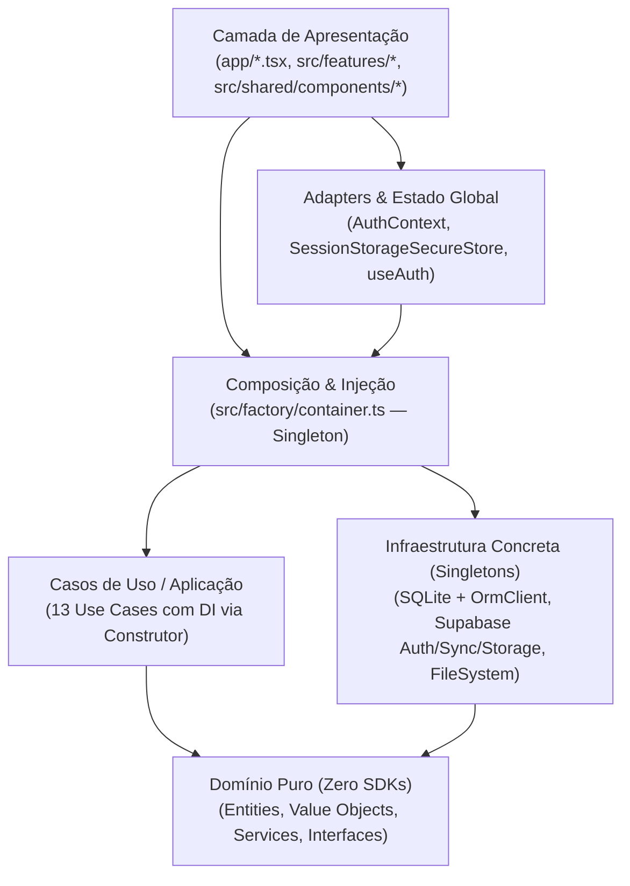
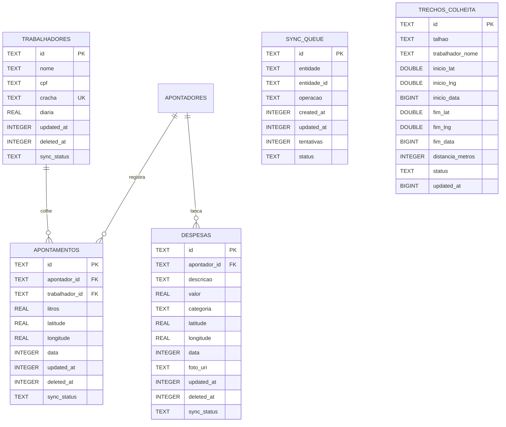
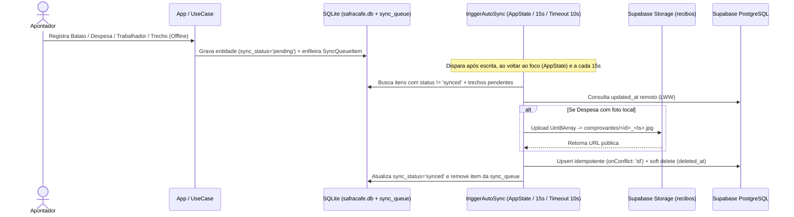

# Documentação Completa do Sistema — SafraCafé

> **Aplicativo:** SafraCafé — Gestão Operacional e Financeira da Colheita Cafeeira (Offline-First)  
> **Identificador do Pacote:** `com.safracafe.app` (`scheme: safracafe`)  
> **Versão:** `1.0.0` (Runtime OTA `1.0.0` · Canal `preview`)  
> **Organização Expo / EAS:** `@joaopedroscalionis-team/safracafe` (`projectId: 374585a6-fe2a-4f11-83f0-8672f705efb0`)

---

## 1. Visão Geral, Problema, Cliente e Perfis

### 1.1 O que é e qual problema resolve
O **SafraCafé** substitui a caderneta de papel e controles improvisados na colheita do café por um aplicativo móvel **100% funcional sem internet (Offline-First)**. Ele resolve:
1. **Erros de apontamento manual:** identificação imediata do colhedor via leitura de **QR Code** no crachá.
2. **Falta de sinal 3G/4G nas lavouras:** gravação local imediata no banco **SQLite** com fila transacional (`sync_queue`) que sobe automaticamente ao Supabase ao recuperar conexão.
3. **Extravio de notas fiscais/recibos:** foto imediata do comprovante na despesa com envio ao **Bucket S3 (`recibos`)**.
4. **Drenagem de bateria por GPS contínuo:** captura georreferenciada **sob demanda (Modo Eco)** apenas nos instantes de lançamento de balaios, despesas e marcação de início/fim do trecho de colheita.

### 1.2 Cliente Principal e Público-Alvo
- **Cliente Principal:** Produtor rural de café (pequeno, médio e grande porte), cooperativas e administradoras de fazendas cafeeiras.
- **Público-Alvo:** Apontadores/fiscais de campo, gestores financeiros da propriedade e trabalhadores apanhadores de café.

### 1.3 Perfis de Usuário
| Perfil | Representação Técnica | Responsabilidades e Acesso |
|---|---|---|
| **Apontador (Operador de Campo)** | `User` / `Session` autenticada via Supabase (`joao@safracafe.com`) + `public.profiles` | Cadastra/edita/exclui trabalhadores, gera/imprime crachás QR Code offline, lê QR Codes, lança balaios, fotografa despesas e registra trechos no mapa. |
| **Trabalhador / Colhedor** | Entidade `Trabalhador` (SQLite + Supabase), rota `/trabalhador/[id]` | Identificado pelo crachá único (`TRAB-01` Cleiton, `TRAB-2` Ana, etc.); possui histórico individual de balaios e ficha cadastral com CPF mascarado (LGPD). |
| **Gestor / Auditor Cloud** | Acesso ao Painel Resumo + Supabase Dashboard | Audita tabelas sincronizadas (`trabalhadores`, `apontamentos`, `despesas`, `trechos_colheita`) e comprovantes públicos no bucket S3 `recibos`. |

---

## 2. Stack Tecnológica Completa e Como Cada Recurso é Utilizado

A tabela abaixo lista todas as tecnologias e bibliotecas reais configuradas em `package.json`, `app.json` e `eas.json`:

| Categoria | Tecnologia / Pacote (Versão) | Arquivos Principais | Como é Utilizado no SafraCafé |
|---|---|---|---|
| **Framework Base** | `expo` (`~58.0.25`), `react-native` (`0.88.1`), `react` (`19.3.0`), `typescript` (`~6.0.0`) | `package.json`, `tsconfig.json` | Runtime mobile multiplataforma com suporte a New Architecture e tipagem estrita. |
| **Navegação** | `expo-router` (`~58.0.31`), `@react-navigation/drawer` (`^7.3.0`), `@react-navigation/bottom-tabs` (`^7.3.0`) | `app/_layout.tsx`, `app/(drawer)/_layout.tsx`, `app/(drawer)/(tabs)/_layout.tsx`, `app/trabalhador/[id].tsx`, `app/modal.tsx` | Roteamento baseado em arquivos: Login (`index`), Drawer com botão de saída seguro, 4 Abas (`Apontamento`, `Despesas`, `Pontos/Mapa`, `Trabalhadores`), detalhes por ID e modal de sincronização. |
| **Persistência Local (SQLite + ORM)** | `expo-sqlite` (`~58.0.17`) + ORM próprio | `DatabaseClient.ts`, `OrmSchema.ts`, `OrmClient.ts`, `Sqlite*Repository.ts` | Banco local `safracafe.db` com `PRAGMA foreign_keys = ON`, tabelas `apontadores`, `trabalhadores`, `apontamentos`, `despesas` e `sync_queue`. Inclui fallback automático em memória se SQLite nativo não estiver disponível. |
| **Backend BaaS** | `@supabase/supabase-js` (`^2.118.0`) | `SupabaseConfig.ts`, `SupabaseClient.ts`, `SupabaseAuthGateway.ts`, `SupabaseSyncGateway.ts`, `SupabaseStorageGateway.ts` | Autenticação JWT, PostgreSQL com RLS ativo (5 tabelas) e Storage S3 (bucket `recibos`) para upload binário (`Uint8Array`) das fotos de despesas. |
| **Câmera (QR Scanner)** | `expo-camera` (`~58.0.14`) | `app/(drawer)/(tabs)/index.tsx` | Leitura instantânea de crachás com `<CameraView barcodeScannerSettings={{ barcodeTypes: ['qr'] }} />` selecionando o trabalhador automaticamente. |
| **Câmera (Recibos)** | `expo-image-picker` (`~58.0.10`) | `app/(drawer)/(tabs)/despesas.tsx`, `LocalReceiptStorage.ts` | Captura da nota fiscal/recibo com compressão (`quality: 0.6`) e persistência local em arquivo antes da sincronização para o S3. |
| **QR Code 100% Offline** | `qrcode` (`^1.5.4`), `@types/qrcode` (`^1.5.6`) | `crachaHelper.ts`, `CrachaModal.tsx` | Gera localmente no aparelho a matriz booleana (renderizada em `<View>` React Native no modal) e o `<svg>` vetorial inline no HTML de impressão — **zero dependência de internet ou API externa**. |
| **Impressão e Compartilhamento** | `expo-print` (`~58.0.9`), `expo-sharing` (`~58.0.23`), `expo-file-system` (`~58.0.13`) | `crachaHelper.ts`, `trechosStorage.ts`, `MapaLavoura.native.tsx`, `LocalReceiptStorage.ts`, `SupabaseStorageGateway.ts` | Geração e impressão/PDF de crachás com QR Code, salvamento local dos trechos de colheita (`safracafe_trechos_colheita.json`), escrita do HTML do mapa em cache e leitura Base64 de recibos. |
| **Geolocalização** | `expo-location` (`~58.0.22`) | `locationHelper.ts`, `trechosStorage.ts`, telas de apontamento/despesas/mapa | Captura pontual sob demanda: lê `getLastKnownPositionAsync()` + corrida `Promise.race` de 4s com `getCurrentPositionAsync({ accuracy: Balanced })` + fallback seguro (`-21.2488, -44.9998`). Distância de trechos calculada pela **Fórmula de Haversine**. |
| **Mapa & Cartografia** | `@expo/dom-webview` + `expo-linking` (`~58.0.17`) | `mapHtmlBuilder.ts`, `MapaLavoura.native.tsx`, `MapaLavoura.web.tsx` | Motor cartográfico **Web Mercator autônomo em HTML5** (zero CDN externo): renderiza tiles reais de **Satélite Híbrido (`lyrs=y`)**, **Mapa Padrão (`lyrs=m`)** e **Terreno (`lyrs=p`)** do Google Maps (`mt0..3.google.com`) com backup automático Esri/OpenStreetMap e grade topográfica offline embutida. Suporta arraste, pinça, duplo toque, zoom `+`/`-`, pins com card informativo e atalho para abrir a rota no app nativo Google Maps (`Linking.openURL`). |
| **Segurança de Sessão** | `expo-secure-store` (`~58.0.3`), `expo-crypto` (`~58.0.8`) | `SessionStorageSecureStore.ts`, `SupabaseClient.ts`, `*Repository.ts` | Armazena tokens/sessão no Android Keystore / iOS Keychain e gera UUID v4 locais via `expo-crypto`. |
| **Build & Updates OTA** | `expo-updates` (`~58.0.22`), EAS Build, EAS Update | `OtaUpdatePrompt.tsx`, `app/_layout.tsx`, `app.json`, `eas.json` | Compilação de `.apk` na nuvem (EAS Build) e modal interativo **"Atualização do Sistema"** via `Updates.useUpdates()` + `AppState` + botão `"OK, Atualizar"` (`reloadAsync()`). |
| **UX & Mídia Auxiliar** | `expo-image`, `expo-haptics`, `expo-constants`, `@expo/vector-icons`, `react-native-gesture-handler`, `react-native-reanimated` | Interface das telas e navegação | Exibição otimizada de fotos/recibos com zoom, feedback tátil e navegação fluida por abas e drawer. |
| **Qualidade & Testes** | `jest` (`~30.5.2`), `jest-expo` (`~58.0.14`), `@testing-library/react-native` (`^14.0.0`), `eslint-config-expo` (`~58.0.4`) | `tests/**/*` (39 suítes / 146 testes) | Cobertura unitária e de componentes abrangendo Domínio, Casos de Uso, Repositórios SQLite/ORM, Gateways Supabase, Adapters, Utilitários e Telas. |

---

## 3. Arquitetura de Software (DDD + Clean Architecture)

O sistema separa rigorosamente regras de negócio de detalhes de infraestrutura e SDKs nativos:



### Regras Estruturais Mantidas
1. **`src/domain/` é 100% puro:** não importa `infra/`, `usecases/`, `expo-*`, `react-native` nem `@supabase/supabase-js`.
2. **Value Objects imutáveis com autovalidação:** `Coordinates`, `QuantidadeBalaio`, `ValorMonetario`, `SyncStatus`.
3. **Entidades com invariantes protegidas:** `Trabalhador`, `Apontamento`, `Despesa`, `SyncQueueItem`, `Session`, `User`.
4. **Injeção de Dependência:** todos os 13 casos de uso (`CadastrarTrabalhador`, `EditarTrabalhador`, `ExcluirTrabalhador`, `ListarTrabalhadores`, `RegistrarApontamento`, `ListarApontamentos`, `RegistrarDespesa`, `ListarDespesas`, `ExcluirDespesa`, `AuthenticateUser`, `RestoreSession`, `SignOut`, `SyncPendingQueue`) recebem contratos do domínio via construtor, conectados exclusivamente em `src/factory/container.ts`.
5. **Padrão Singleton:** repositórios SQLite, gateways Supabase e `container` utilizam `private constructor()` + `getInstance()`.

---

## 4. Persistência Local (SQLite + FileSystem) e Remota (Supabase)

### 4.1 Modelo Entidade-Relacionamento


### 4.2 Seeds Locais e Persistência Auxiliar
- **Seed inicial SQLite (`DatabaseClient.ts`):** ao inicializar vazio, semeia os trabalhadores oficiais **Cleiton (`TRAB-01`, R$ 100,00)** e **Ana (`TRAB-2`, R$ 120,00)** com `sync_status = 'synced'`.
- **Comprovantes locais (`LocalReceiptStorage.ts`):** salva fotos das despesas em armazenamento local antes de enviá-las na sincronização.
- **Trechos da colheita (`trechosStorage.ts`):** persiste `trechoAtivo` e `historico` em `safracafe_trechos_colheita.json` para funcionamento offline contínuo e sincroniza todos os registros com `public.trechos_colheita` no Supabase.

---

## 5. Metodologia de Sincronização (Outbox + LWW + S3 + Retomada Resiliente)



### Detalhes de Confiabilidade Implementados
- **Retentativa automática (`SqliteSyncQueueRepository.findPending`):** consulta `status != 'synced'`, portanto registros marcados como `'error'` durante perda de sinal voltam a ser tentados automaticamente quando a conexão retorna.
- **Proteção contra sockets travados (`autoSync.ts`):** `Promise.race` com `SYNC_TIMEOUT_MS = 10000` impede que a trava `isSyncing` fique presa em redes rurais instáveis.
- **Verificação de erro no LWW (`SupabaseSyncGateway.ts`):** checa `selectError` antes de prosseguir, mantendo o item na fila local se a consulta ao servidor falhar.
- **Garantia de integridade referencial:** antes de sincronizar um apontamento, `SupabaseSyncGateway` verifica/sobe o trabalhador referenciado caso tenha sido cadastrado offline no mesmo lote.

---

## 6. Módulos Específicos de Campo (Câmera, GPS, QR Code Offline e Mapa)

### 6.1 Leitura de QR Code e Crachás 100% Offline
1. No cadastro/edição do trabalhador, gera-se um crachá com QR Code em [`CrachaModal.tsx`](../src/shared/components/CrachaModal.tsx) usando **`qrcode`** (`gerarMatrizQrCode` + matriz de `<View>`), funcionando totalmente sem internet.
2. A impressão/PDF em [`crachaHelper.ts`](../src/shared/utils/crachaHelper.ts) embute um **`<svg>` vetorial** gerado localmente (`gerarSvgQrCode`) em HTML enviado para `expo-print` / `expo-sharing`.
3. Na tela de apontamento, o botão de câmera abre `CameraView` (`expo-camera`) filtrado para `qr` e seleciona o trabalhador correspondente ao código lido.

### 6.2 Mapa Interativo Estilo Google Maps (`DomWebView`)
- Para evitar bloqueios de chave SDK nativa do `react-native-maps` em dispositivos Android no canal interno, [`MapaLavoura.native.tsx`](../src/features/mapas/MapaLavoura.native.tsx) e [`mapHtmlBuilder.ts`](../src/features/mapas/mapHtmlBuilder.ts) renderizam um **motor Web Mercator autônomo em `@expo/dom-webview`** (arquivo HTML salvo em cache local).
- **Camadas alternáveis em tempo real:**
  - **Satélite (`lyrs=y`)** com fallback automático para *Esri World Imagery*;
  - **Padrão (`lyrs=m`)** com fallback automático para *OpenStreetMap*;
  - **Terreno (`lyrs=p`)** com curvas de nível e fallback *OSM*.
- **Interatividade:** gestos de arraste (1 dedo com `nestedScrollEnabled`), pinça (2 dedos), duplo toque, botões `+`/`−`, `Enquadrar Tudo`, `Minha Posição`, pins estilizados com popups ao tocar e botão para abrir a coordenada no app nativo Google Maps (`Linking.openURL`). Caso o aparelho esteja sem internet para baixar tiles, exibe grade de fundo mantendo rotas, metragens e marcadores visíveis.

---

## 7. Segurança na Nuvem e no Dispositivo

1. **Armazenamento Seguro de Sessão (`SessionStorageSecureStore`):** JWT e dados de sessão salvos criptografados em hardware (Android Keystore / iOS Keychain) via `expo-secure-store`.
2. **Row Level Security (RLS):** ativado nas tabelas remotas em `supabase/migrations/01_schema_and_rls.sql` e `supabase/fix_rls_and_bucket.sql`.
3. **Bucket S3 (`recibos`):** políticas explícitas restringindo escrita/leitura a `bucket_id = 'recibos'`.
4. **Sanitização e Privacidade (LGPD):** `sanitizeUuidOrNull()` valida UUIDs antes do `upsert`; tela de detalhes (`/trabalhador/[id]`) aplica máscara no CPF (`***.XXX.XXX-**`); variáveis sensíveis isoladas em `.env` (`.gitignore`), utilizando apenas a chave pública `anon` no cliente mobile.

---

## 8. Build Android (`.apk`), Atualizações OTA Interativas e Verificação

### 8.1 Pipeline EAS Build & EAS Update
- **APK Android (perfil `preview`):** compilado via EAS Build (`buildType: "apk"`).
- **Atualizações Over-the-Air (`OtaUpdatePrompt.tsx`):** monitora `Updates.useUpdates()` (`isUpdateAvailable`, `isUpdatePending`, `isDownloading`) e escuta o retorno do aplicativo ao primeiro plano (`AppState`). Quando há nova versão, exibe o modal **"Atualização do Sistema"** com o botão **"OK, Atualizar"** (baixa se necessário e chama `Updates.reloadAsync()` em tela, sem precisar fechar e abrir o APK manualmente) ou **"Depois"**.

### 8.2 Comandos de Verificação de Qualidade

```bash
npm run db:check       # Confere tabelas no Supabase e arquivos no bucket S3 'recibos'
npx tsc --noEmit       # Verificação estrita de tipos TypeScript (0 erros)
npm run lint           # ESLint / Expo Lint (0 erros e 0 avisos)
npx expo-doctor        # Diagnóstico oficial Expo (20/20 checks aprovados)
npm test               # Suíte Jest + RNTL (39 suítes / 146 testes aprovados)
```
